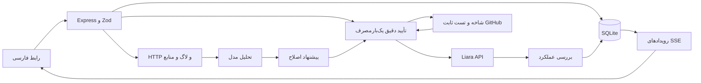

# معماری و محدودیت‌ها

رابط React/TypeScript/Vite، Tailwind و Radix با RTL است. بک‌اند Express/Zod، ذخیره‌سازی SQLite و پیشرفت SSE دارد. مدل فقط تحلیل ساختاریافته و پیشنهاد محتوای یک فایل می‌دهد؛ ابزار shell یا تغییر زیرساخت در اختیار مدل نیست.

## داده و مجوز

Project، Inspection/SourceArtifact، Operation، Approval و Incident در SQLite ثبت می‌شوند. PatchProposal داخل عملیات repair-test شامل base SHA، diff، commit خروجی و تست است. نشست‌ها هش شناسه، CSRF و انقضا دارند؛ رمز خام ذخیره نمی‌شود.

تأیید ۱۰ دقیقه اعتبار دارد و به پارامترهای canonical، مقصد و مالک متصل است. مصرف در تراکنش انجام می‌شود؛ دوبار کلیک تأیید دوبار اجرا نمی‌کند. هر پروژه یک عملیات running دارد. SSE پس از reconnect وضعیت ذخیره‌شده را می‌فرستد. restart بک‌اند وضعیت release را تطبیق می‌دهد؛ عملیات نامطمئن دوباره نوشته نمی‌شود و `needs_review` می‌گیرد. تغییر هم‌زمان از پنل بیرون از کنترل برنامه است و نیازمند بررسی اپراتور است.

## سورس و اصلاح

GitHub ref به SHA ثابت تبدیل می‌شود. آرشیو فقط از GitHub و redirect مجاز codeload دریافت می‌شود؛ Authorization به redirect منتقل نمی‌شود. سقف ۲۰ MiB فشرده، ۱۰۰ MiB مجموع فایل‌ها و ۵۰۰۰ ورودی است. مسیر مطلق، traversal، symlink، hardlink، مسیرهای ویژه Windows و ریشه‌های متعدد رد می‌شوند. نام فایل‌های شناخته‌شده حساس فیلتر می‌شود؛ این جای اسکن secretهای hardcoded نیست.

آرشیو از ریشه بازبسته‌بندی و checksum قبل از ارسال تطبیق داده می‌شود. هیچ کد مخزن یا مدل روی سرور دستیار اجرا نمی‌شود. فقط `src/checkout.mjs` در مخزن مجاز تغییر می‌کند. workflow و تست رفتاری در base و commit خروجی با نسخه ثابت محلی مقایسه می‌شوند. موفقیت CI باید متعلق به همان SHA و مخزن باشد. runner فاقد secret لیارا/مدل و credential ماندگار checkout است. شکست یا نبود نتیجه تست، انتشار را متوقف می‌کند.

بسته‌بند فایل `hamyar-build.json` را با SHA پین‌شده تولید و در checksum آرشیو لحاظ می‌کند؛ فایل هم‌نام در مخزن منبع اعتماد نیست و بازنویسی می‌شود. نمونه این مقدار را هنگام شروع فرایند می‌خواند و در هدر `X-Hamyar-Commit` پاسخ می‌دهد. تأیید انتشار نمونه در تمام probeها به همین SHA وابسته است و انتشار فعال لیارا پیش و پس از probeها تطبیق داده می‌شود. نسخه‌های قدیمی نمونه بدون این هدر دیگر قابل تأیید نیستند. برای پروژه عمومی فاقد این قرارداد، هویت runtime از HTTP اثبات نمی‌شود؛ فقط تطبیق انتشار فعال و بررسی عملکرد انجام می‌شود. این هدر تضمین امنیت در برابر کد عمداً متقلب نیست؛ هدف تشخیص پاسخ نسخه قدیمی در rollout نمونه است.

## بررسی و پایش

آماده‌شدن release کافی نیست: سه probe سلامت و، برای نمونه، پرداخت و checkout با مبلغ مورد انتظار بررسی می‌شوند. درخواست حادثه پس از اصلاح تکرار می‌شود. کد خراب می‌تواند commit جاری شود ولی آخرین commit سالم را بازنویسی نمی‌کند. بازیابی فقط انتشار مجدد کد است؛ دیتابیس rollback نمی‌شود.

probe به HTTPS دامنه ثبت‌شده محدود است؛ DNS عمومی بررسی و IP اتصال pin می‌شود. redirect دنبال نمی‌شود؛ پاسخ و زمان انتظار سقف دارند. تغییر خودکار URL پایش به دامنه سفارشی هنوز پیاده نشده است.

پایش سبک هر ۶۰ ثانیه، سه شکست متوالی و فاصله ۱۰ دقیقه بین تحلیل خودکار دارد. فقط یک تحلیل فعال برای هر پروژه اجرا می‌شود. خاموشی سرور محلی پایش را متوقف می‌کند. CPU/RAM خام با زمان و وضعیت دسترسی ارائه می‌شوند؛ نمودار و تبدیل واحد تا تأیید پاسخ واقعی تکمیل نشده‌اند.

## محدودیت‌ها

- تک‌مالک، تک‌نمونه و پروژه ساده Node.js؛ monorepo و چندزبان پشتیبانی نمی‌شوند.
- گفت‌وگوی UI راهنمای مسیر با قواعد محدود فارسی است؛ درخواست مبهم به انتخاب بخش منجر می‌شود و checkout با POST و بدنه آزمایشی همان مسیر بررسی می‌شود. تحلیل حادثه و patch از مدل می‌آیند.
- پیشنهاد پلن ارزان‌ترین ترکیب تأییدشده برای شروع benchmark است، نه تضمین ظرفیت تولیدی.
- مقادیر env با AES-GCM رمزگذاری و از کارت و رویداد حذف می‌شوند. پالایش لاگ همه انواع داده حساس ناشناخته را تضمین نمی‌کند.
- ورود scrypt، cookie HttpOnly/SameSite و Secure در production، CSRF و محدودسازی تلاش ورود وجود دارد.
- هزینه و تغییر env تا تأیید قرارداد واقعی API مسدودند؛ نبود داده به معنی صفر نیست.
- DNS خارج از لیارا دستی است؛ تغییر خودکار رکوردهای DNS در این نسخه وجود ندارد.
- نمونه آنلاین، مدل، workflow ریموت، اصلاح و restart نمونه آزمایش شده‌اند؛ API ساخت دیسک برای استقرار دستیار آنلاین با خطای `not_enough_storage_space` پاسخ داد و آزمون restart با دیسک پایدار ممکن نشد.

نتیجه CI موفق برای SHA، مخزن و پروژه دقیق ذخیره می‌شود؛ انتشار بعدی همان مدرک تغییرناپذیر را مصرف می‌کند. بازبینی قرارداد workflow و تست پیش از انتشار همچنان انجام می‌شود. job شکست‌خورده حتی پیش از اتمام کل workflow مانع انتشار است؛ job موفق به‌تنهایی کافی نیست. پس از restart، checkpoint شاخه و SHA حفظ و وضعیت موجود خوانده می‌شود.

پس از READY، بررسی عملکرد با انتظار محدود برای rollout انجام می‌شود. دکمهٔ بررسی مجدد انتشار فعال، بدون نوشتن خارجی، release فعلی را قبل و بعد از probe با عملیات تطبیق می‌دهد؛ فقط سپس وضعیت حادثه و آخرین commit سالم به‌روز می‌شود.
